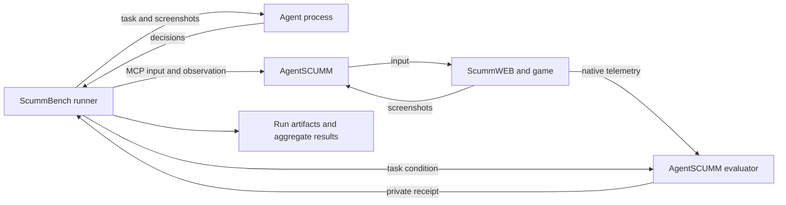

# Architecture

ScummBench is the benchmark owner. It does not implement an adventure-game
engine, puzzle solver, or general agent framework.

AgentSCUMM's public launcher now always delegates to `scummbench mcp`. The
ScummBench gateway preserves the native tool interface, records interactive
evidence, and reports mediation provenance through `status.scummbench`. Missing
ScummBench blocks launch; the managed internal backend is not a public fallback.
Fixed-task runs use that same internal mechanical backend under the runner.

## Ownership

| Component | Owns |
| --- | --- |
| ScummWEB | Game runtime, native game maps, story-progress semantics |
| AgentSCUMM | Mechanical MCP controls, captures, isolation of game profiles, native telemetry and condition evaluation |
| ScummBench | Versioned tasks, player policy, budgets, orchestration, result validation, artifacts and statistics |
| Participating agent | Model selection, planning, memory and puzzle solving |

The reference adapter launches a fresh AgentSCUMM process for each attempt with
an exclusive profile under its run directory. It pins the source commit and
checks the running server's reported revision. Evaluation flags are set by the
runner before the game starts. The player receives no raw engine variables,
evaluation condition, receipt, MCP connection, or runtime file paths through
the player protocol.

This is data-flow separation, not an OS security boundary. A process on the same
host can potentially inspect files, processes, network traffic, and source. Do
not run untrusted agents in this development mode or advertise its results as
enforced closed-book evaluation.

## Execution

1. Validate the selected task, backend configuration, and pinned clean source.
2. Create a new exclusive run directory; preserve the exact task bytes and hash.
3. Initialize MCP, validate its source revision, and start Queen with a fresh profile.
4. Wait for ready and reject a starting state that already satisfies the goal.
5. Send the visible objective and first screenshot to the agent process.
6. Validate decisions, charge budgets before forwarding input, and archive captures.
7. Independently monitor the native result, including while the agent is thinking.
8. Validate success against the expected condition, session, game, and source.
9. Stop the owned agent and backend process groups and write a final manifest.

Each process group belongs to this attempt; unrelated servers and profiles are
never stopped. Fresh profile means no reused browser storage or saves, not a
claim that engine initialization is deterministic.

## Repository layout

- `tasks/`: versioned task contracts; currently one Queen development task.
- `schemas/`: machine-readable task and result contracts.
- `src/backend.js`: AgentSCUMM MCP adapter and independent receipt validation.
- `src/runner.js`: agent loop, budget enforcement, lifecycle, and artifacts.
- `src/aggregate.js`: compatible-group summaries with uncertainty estimates.
- `examples/`: a protocol observer, without gameplay logic or model calls.
- `test/fixtures/`: synthetic agent and MCP backend.

The minimal MCP client supports stdio JSON-RPC and the initialization, tool-list,
and tool-call operations needed here. It offers no sampling, roots, elicitation,
HTTP transport, or general MCP proxy. Unsupported server requests are rejected.
