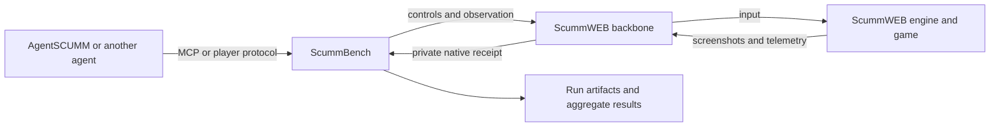

# Architecture

ScummBench is the benchmark owner. It does not implement an adventure-game
engine, puzzle solver, or general agent framework.

The dependency direction is **AgentSCUMM → ScummBench MCP → ScummWEB backbone**.
AgentSCUMM supplies gameplay procedures, planning and memory. Its launcher calls
`scummbench mcp`; ScummBench never starts or imports AgentSCUMM code.
ScummBench's gateway records interactive evidence and mediation provenance.
Fixed-task runs use the same ScummWEB mechanical backbone under the runner.

## Ownership

| Component | Owns |
| --- | --- |
| ScummWEB | Game runtime, native maps, progress semantics, controls, captures, profiles, spectator and native receipts |
| ScummBench | Tasks, player policy, budgets, MCP mediation, orchestration, grading, portable archive verification and results |
| AgentSCUMM or another agent | Model selection, planning, memory and puzzle solving |

Each attempt launches a fresh ScummWEB backbone with an exclusive profile under
its run directory. The adapter pins the ScummWEB checkout and validates its
reported startup revision. Evaluation flags are set before the game starts.
The player receives no raw engine variables, evaluation condition, receipt,
MCP connection, or runtime file paths through the player protocol.

This is data-flow separation, not an OS security boundary. A process on the same
host can potentially inspect files, processes, network traffic, and source. Do
not run untrusted agents in this development mode or advertise its results as
enforced closed-book evaluation.

## Execution

1. Validate the selected task, backend configuration, and pinned clean source.
2. Create a new exclusive run directory; preserve the exact task bytes and hash.
3. Initialize MCP, validate its source revision, and start Queen with a fresh profile.
4. Wait for ready and reject a starting state that already satisfies the goal.
5. Send the visible objective and first screenshot to the agent process.
6. Validate decisions, charge budgets before forwarding input, and archive captures.
7. Independently monitor the native result, including while the agent is thinking.
8. Validate success against the expected condition, session, game, and source.
9. Stop the owned agent and backend process groups and write a final manifest.

Each process group belongs to this attempt; unrelated servers and profiles are
never stopped. Fresh profile means no reused browser storage or saves, not a
claim that engine initialization is deterministic.

New fixed-task attempts and interactive sessions automatically journal scalar
results and send them to a per-run W&B worker through stdio JSON-RPC. The worker
uses the supplied publishing environment, including its placeholder,
proxy session and process-local CA trust. These settings are not passed to the
game or player. The worker validates the fixed mutation, canonical game project,
run ID and scalar payload; the proxy supplies the credential upstream.
Workers renew their bounded sessions after 20 minutes and revoke them on exit.
Missing route bindings fail setup explicitly. Delivery failures remain in the
private publication receipt and do not alter grades. `--no-wandb` selects offline
operation. See [live reporting](wandb.md) for setup and delivery limits.

## Repository layout

- `tasks/`: versioned task contracts; currently one Queen development task.
- `schemas/`: machine-readable task and result contracts.
- `src/backend.js`: ScummWEB backbone adapter and independent receipt validation.
- `src/runner.js`: agent loop, budget enforcement, lifecycle, and artifacts.
- `src/aggregate.js`: compatible-group summaries with uncertainty estimates.
- `examples/`: a protocol observer, without gameplay logic or model calls.
- `test/fixtures/`: synthetic agent and MCP backend.

The minimal MCP client supports stdio JSON-RPC and the initialization, tool-list,
and tool-call operations needed here. It offers no sampling, roots, elicitation,
HTTP transport, or general MCP proxy. Unsupported server requests are rejected.
